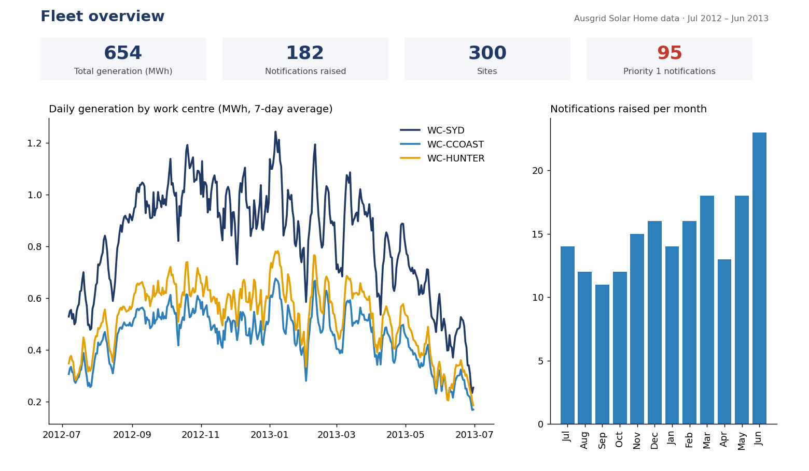
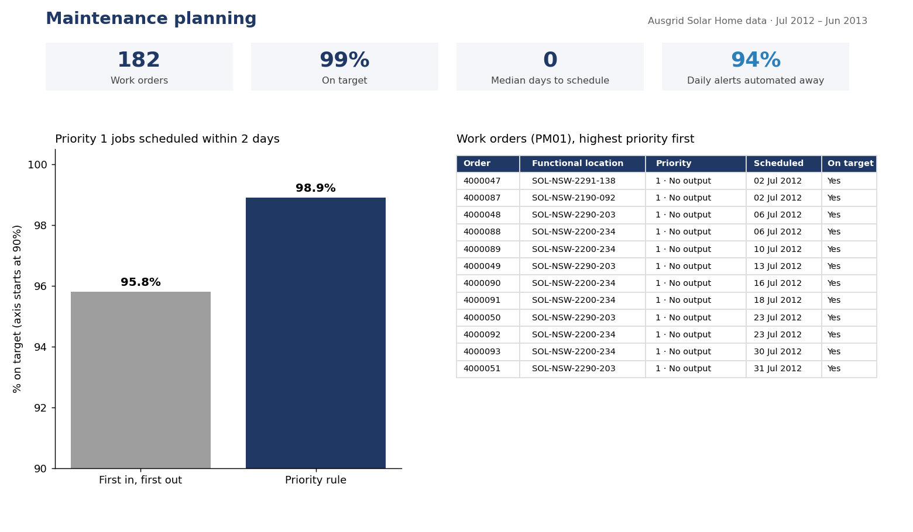
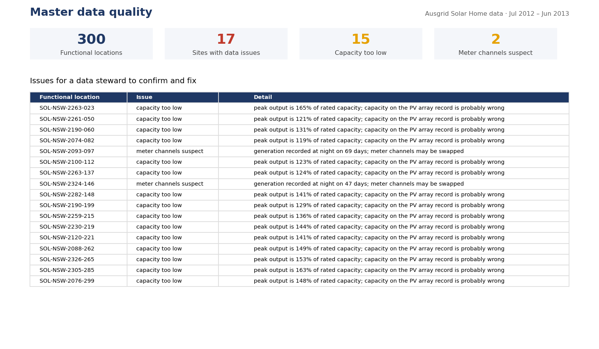

# Solar maintenance planner


Fault alerts are only useful if they become planned maintenance. This project takes a year of real alerts from 300 rooftop solar systems (from [solar-fleet-health](https://github.com/Inzela2/solar-fleet-health)) and automates the path a maintenance team follows: **SAP PM-style master data → maintenance notifications → scheduled work orders → a Power BI planning dashboard**.

## Dashboard





These pages are rendered in Python (`python -m maintplan.dashboard`) from the same star schema and measures as the Power BI build in `powerbi/`.

## Results

- **2,916 daily alerts became 182 maintenance notifications, 94% fewer items** for a planner to triage by hand. Consecutive alert days for the same fault merge into one notification, and short underperformance dips must persist 3 days before a notification is raised.
- **Priority scheduling raised on-time response for priority 1 jobs (no output) from 95.8% to 98.9%** compared with first-in-first-out, with one crew job per work centre per working day.
- **17 master data problems found and logged** for a data steward: 15 PV arrays whose recorded capacity is too low for their measured output, and 2 meters whose channels look swapped.

## How it maps to SAP PM

| This project | SAP PM object | Fields used |
|---|---|---|
| Each rooftop system | Functional location | TPLNR, PLTXT |
| PV array and meter | Equipment | EQUNR, EQKTX |
| Region crew | Work centre | ARBPL (Sydney, Central Coast, Hunter) |
| Fault episode | Notification, type M2 (malfunction) | QMNUM, QMART, PRIOK, QMTXT, QMDAT |
| Scheduled job | Order, type PM01 (corrective) | AUFNR, AUART |

## Design decisions

| Decision | Why |
|---|---|
| Merge consecutive alert days into one notification | A site down for 30 days needs one job, not 30 tickets. |
| 3-day confirmation for underperformance; outages raised immediately | The fault-detection evaluation showed short dips cause most false alarms, while outages are certain and urgent. |
| Compare priority scheduling with first-in-first-out | A scheduling rule only earns its place if it beats the obvious default. |
| Skip weekends in scheduling | Crews don't work weekends, so a Friday notification waits until Monday unless it's urgent. |
| Star schema for Power BI (dimensions + facts) | Power BI filters and aggregates correctly and fast with one-to-many relationships from small dimension tables to fact tables. |
| Log master data issues instead of auto-correcting them | A wrong capacity needs a human to confirm the real value; silently "fixing" it would hide the problem. |

## Power BI, Power Automate and Power Apps

`powerbi/` holds the ready-to-load star schema (`dim_site`, `dim_date`, `dim_equipment`, `fact_daily_generation`, `fact_notifications`, `fact_work_orders`, `master_data_issues`), DAX measures in `measures.dax`, and `BUILD_GUIDE.md` with step-by-step instructions for:
- a three-page Power BI dashboard (fleet overview, maintenance planning, master data quality);
- a Power Automate flow that posts priority 1 notifications to Teams;
- a Power Apps form for technicians to close work orders.

## Run it

```bash
pip install -e ".[dev]"
pytest                 # 6 tests
python -m maintplan              # rebuilds powerbi/ and results/ from data/
python -m maintplan.dashboard    # renders the dashboard pages
```

Data: [Ausgrid Solar Home Electricity Data](https://www.ausgrid.com.au/Industry/Our-Research/Data-to-share/Solar-home-electricity-data) (CC BY), processed by solar-fleet-health. SAP PM field names are used to show the mapping; this project does not connect to an SAP system.
